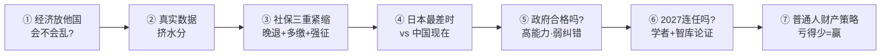
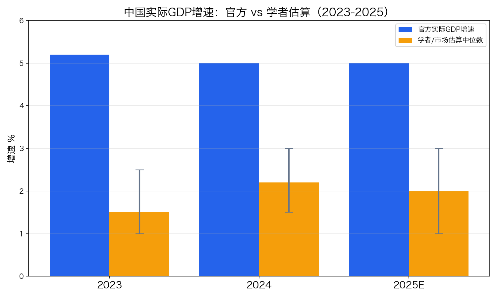
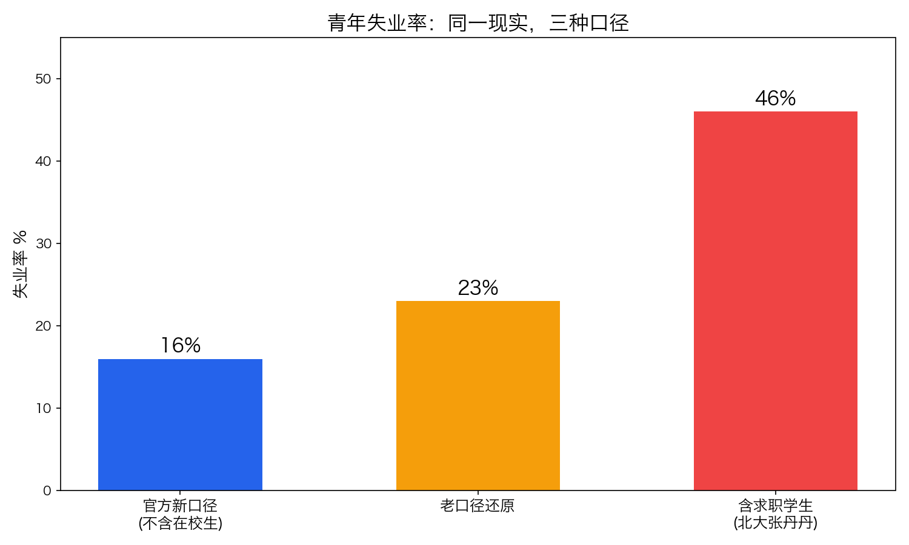
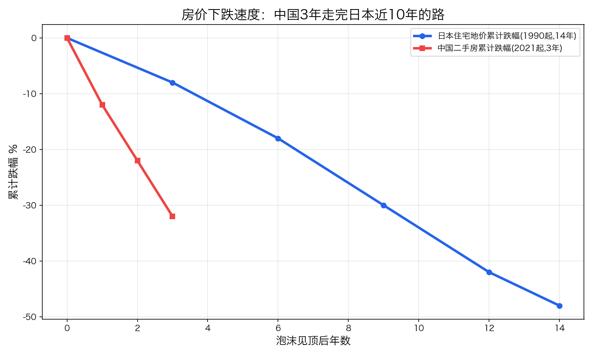
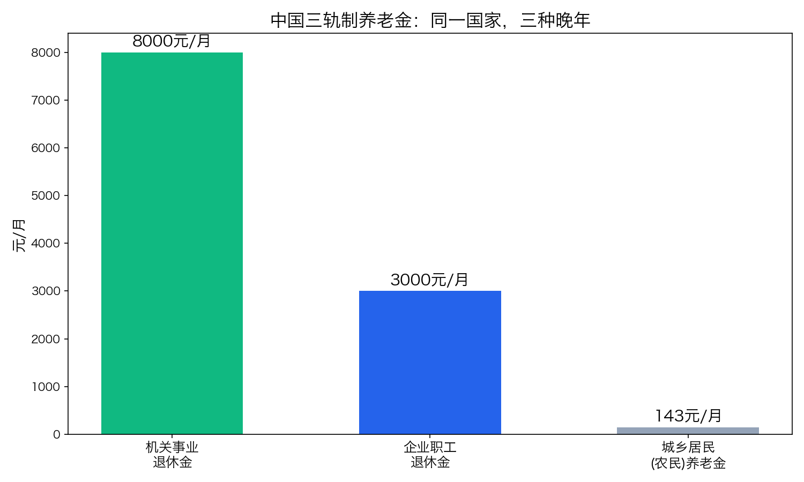
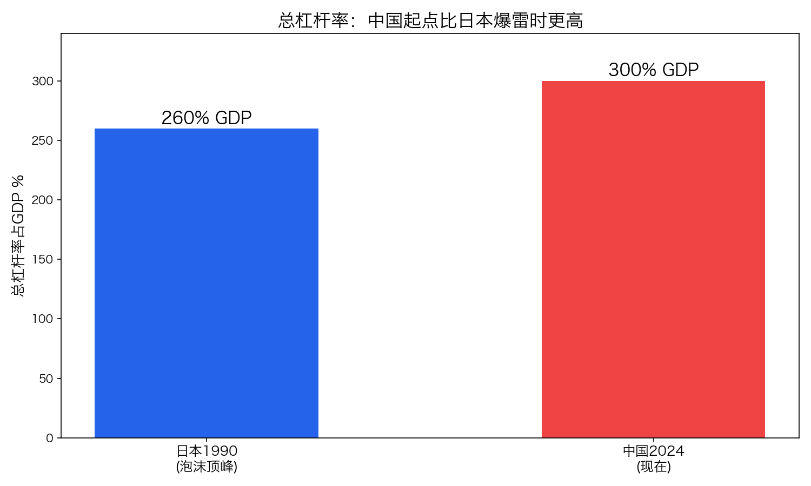
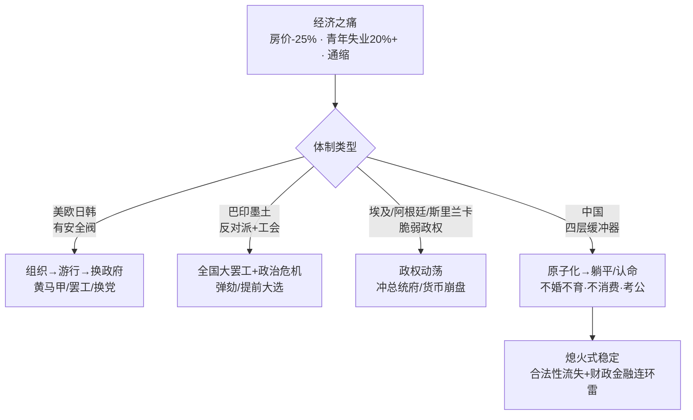
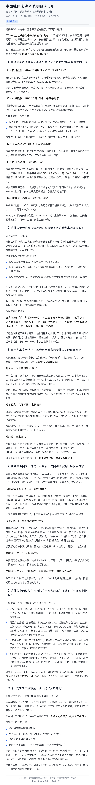
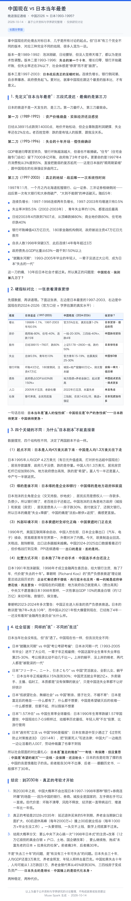

# 2026 中国生存指南：经济 · 社保 · 日本对照 · 政府 · 连任 · 财产策略

> 一次关于 2026 年中国经济真相的完整追问 —— 从"放他国会不会乱"，到"普通人该怎么办"。
> 共 7 篇 + 2 张分享长图 + 5 张数据图。讨论时间：2026-10-14。

   

⚠️ **免责声明**：本仓库为 AI 辅助的宏观经济与政治讨论整理，仅供学习交流，**不是投资建议**。涉及人事/政策走向的判断均基于公开信息与学术文献，不构成任何行动依据。大额财产决策请咨询持牌专业人士。

---

## 🗺️ 阅读地图



| # | 篇目 | 一句话结论 | 全文 |
|---|------|-----------|------|
| ① | 经济放他国会不会政治动乱？ | 放美欧→换届+黄马甲；放巴印→大罢工；放埃及→政权动荡；在中国=熄火式稳定 | [阅读全文](docs/01-jingji-yu-zhengzhi-dongdang.md) |
| ② | 挤掉水分的真实数据（论文篇） | 每年虚高 1-2pct；2023-25 真实增速中位数约 2% | [阅读全文](docs/02-zhenshi-shuju-jishuifen.md) |
| ③ | 社保改动分析 | 晚退 3-5 年 + 缴费 15→20 年 + 强征；年轻人无声撕毁代际契约 | [阅读全文](docs/03-shebao-gaige.md) |
| ④ | 日本最差时 vs 中国现在 | 中国 ≈ 日本 1993-95，噩梦前半段；下跌速度快 3-4 倍 | [阅读全文](docs/04-zhongri-duibi.md) |
| ⑤ | 政府是个合格的政府吗？ | 高能力、低弹性：执行力 95 分，纠错机制不及格 | [阅读全文](docs/05-zhengfu-pingjia.md) |
| ⑥ | 2027 之后习会连任吗？ | 压倒性多数认为会连；分歧只在连多久、以何形式 | [阅读全文](docs/06-xi-lianren-2027.md) |
| ⑦ | 普通人的财产与投资策略 | 现金为王→降杠杆→小步定投→合规出海；活着就是胜利 | [阅读全文](docs/07-caichan-celve.md) |

---

## 📊 五张图看懂核心结论

### 1️⃣ 官方 GDP vs 学者估算：每年差出 3 个点



> Chen et al.(2019) Brookings：2008-16 每年虚高 1.7pct；Martínez(2022) JPE：威权国家平均虚报 0.9-1.5pct；Rhodium/Capital Economics 估算 2023-25 真实增速 1-3%。详见 [第二篇](docs/02-zhenshi-shuju-jishuifen.md)。

### 2️⃣ 青年失业：同一现实，三种口径



> 官方新口径 15-17%（不含在校生）→ 老口径还原 20-25% → 含求职学生 up to 46%（北大张丹丹）。详见 [第二篇](docs/02-zhenshi-shuju-jishuifen.md)。

### 3️⃣ 房价下跌速度：中国 3 年走完日本近 10 年的路



> 日本住宅跌 40-50% 用了 14 年；中国二手 3 年跌 25-40%、销售面积腰斩。详见 [第四篇](docs/04-zhongri-duibi.md)。

### 4️⃣ 三轨制养老金：同一国家，三种晚年



> 机关 ~8000、企业 ~3000、农民 143 元/月。三轨制最大的政治功能是"分而治之"。详见 [第三篇](docs/03-shebao-gaige.md)。

### 5️⃣ 总杠杆率：中国起点比日本爆雷时更高



> 日本 1990 年总杠杆 ~260%（爆的是企业债）；中国 2024 年 ~300%，企业+政府+居民三张表一起累。详见 [第四篇](docs/04-zhongri-duibi.md)。

---

## 🔗 传导链条：为什么同样的痛，他国上街、中国沉默？



> 四层缓冲器 = 高储蓄+农村退路（经济）→ 网格维稳+属地化解（制度）→ 比下有余+外部归因（认知）→ 组织成本极高（恐惧）。详见 [第一篇](docs/01-jingji-yu-zhengzhi-dongdang.md)。

---

## 🧾 社保逻辑链：保住基金 5 年，透支信任 30 年


> 法国 2023 只晚退 2 年就 1200 万人次上街；俄罗斯 2018 普京亲自电视道歉；中国三项全动却零街头运动 —— 靠的是碎步渐进 + 利益分裂 + 无组织者 + 专挑软柿子。详见 [第三篇](docs/03-shebao-gaige.md)。

---

## 🔭 2027 前观察清单（5 盏信号灯，每年体检一次）

| # | 信号灯 | 🟢 加仓中国资产 | 🔴 维持防守/加速出海 |
|---|--------|----------------|---------------------|
| 1 | 二十一大人事（2027） | 连任 + 改革派冒头 | 连任 + 进一步集权 |
| 2 | 房地产 | 万亿级真注资 + 房价企稳 | 继续"保交楼"糊弄 |
| 3 | 汇率 | 人民币企稳 | 破 8 且管制加码 |
| 4 | 加税立法 | 无动静 | 房产税/遗产税/资本利得税任一落地 |
| 5 | 地缘 | 关税/脱钩缓和 | 台海/关税/脱钩升级 |

> 详见 [第六篇](docs/06-xi-lianren-2027.md)（连任论证）与 [第七篇](docs/07-caichan-celve.md)（动态再平衡）。

---

## 📱 分享长图（2 张，可直接保存发朋友圈/小红书）

### 社保篇长图



### 中日对比篇长图



---

## 📚 核心参考文献（文中引用）

- Chen, W., Chen, X., Hsieh, C.T., Song, Z. (2019). A Forensic Examination of China's National Accounts. *Brookings Papers on Economic Activity*.
- Martínez, L.R. (2022). How Much Should We Trust the Dictator's GDP Growth Estimates? *Journal of Political Economy*, 130(10).
- Rogoff, K., Yang, Y. Peak China Housing. NBER Working Paper 27697.
- Rhodium Group (2023-2024). 系列中国经济替代指标报告；Capital Economics China Activity Proxy (CAP).
- Koo, R. 资产负债表衰退理论（Balance Sheet Recession）；辜朝明相关论述。
- Pierson, P. (1994). *Dismantling the Welfare State?*（避责政治 Blame Avoidance）。
- Davies, J. J 曲线革命理论；Huntington《政治秩序变迁中的社会》；Fukuyama《政治秩序》（国家能力+法治+问责）。
- Alice Miller（胡佛研究所）、Cheng Li（布鲁金斯）、Victor Shih（UCSD）、Neil Thomas（Asia Society）关于中共精英政治与人事布局的公开分析。

---

## 📁 仓库结构

```
├── README.md              # 总览（本页）
├── docs/
│   ├── 01-jingji-yu-zhengzhi-dongdang.md   # ① 经济放他国会不会乱
│   ├── 02-zhenshi-shuju-jishuifen.md       # ② 真实数据论文篇
│   ├── 03-shebao-gaige.md                  # ③ 社保改动
│   ├── 04-zhongri-duibi.md                 # ④ 日本最差 vs 中国现在
│   ├── 05-zhengfu-pingjia.md               # ⑤ 政府评价
│   ├── 06-xi-lianren-2027.md               # ⑥ 2027 连任论证
│   └── 07-caichan-celve.md                 # ⑦ 财产策略
└── assets/
    ├── chart-gdp-gap.png / chart-youth-unemployment.png / ...
    ├── shebao-long.png    # 社保篇分享长图
    └── japan-long.png     # 中日对比篇分享长图
```

---

## ©️ 许可与说明

- 本仓库内容采用 [CC BY 4.0](https://creativecommons.org/licenses/by/4.0/deed.zh) 共享：可转载、改编，需署名并附原文链接。
- 数据图为根据公开讨论口径绘制的示意图（非精确统计），长图为 AI 排版渲染。
- 欢迎提 Issue 讨论、纠错、补充文献。理性交流，拒绝谩骂。
